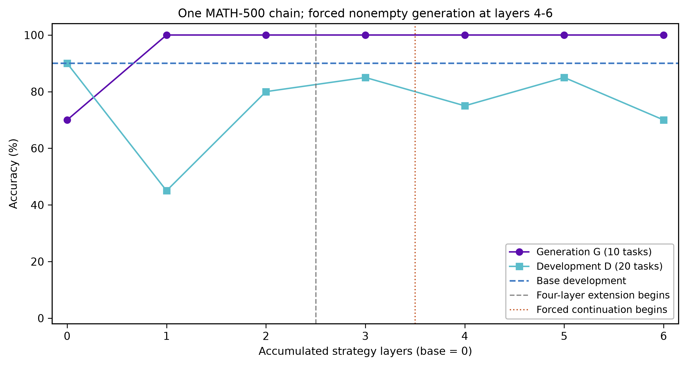

# MATH-500 累计六层递归扩展

按用户指定，从第 3 次修复后实验的 A+C 继续生成四个外层，累计六层策略。前两层与其 G/D 评分沿用原始记录，每个新外层均读取完整祖先策略源码、当前 G 轨迹、当前分数及上一代基线反馈。官方编号为 base=1、六层策略求解器=7。

|策略层数|官方深度|G 正确数|D 正确数|来源|
|---:|---:|---:|---:|---|
|0|1|7/10|18/20|G 沿用，D 新运行|
|1|2|10/10|9/20|沿用|
|2|3|10/10|16/20|沿用|
|3|4|10/10|17/20|新增生成并执行|
|4|5|10/10|15/20|新增生成并执行|
|5|6|10/10|17/20|新增生成并执行|
|6|7|10/10|14/20|新增生成并执行|

开发集选中策略层数 0，平分时选浅层。深度选择冻结后再执行测试。

|测试对象|正确数|准确率|
|---|---:|---:|
|source_base|45/60|75.00%|
|depth6|58/60|96.67%|
|development_best|45/60|75.00%|

六层链相对保存的基线测试输出改对 13 题、改错 0 题，净增加 13 题。逐题配对清单见 paired_test.json，事后选择的一个改对测试例子见 test_case_trajectory.json。

本阶段新增 673,056 token，其中 Ω 生成 161,894，求解 511,162。新增保守费用预留 ¥28.105881，阶段上限 ¥85，项目累计保护上限 ¥250。沿用前两层的历史消耗未重复计入本阶段。

代表题、完整六层上下文传递与输出见 case_trajectory.md 和 case_trajectory.json。每轮 audits/ 和 rounds/ 记录深度、输入来源哈希、实际执行顺序与策略链哈希。

## 解释范围

这是沿一条既有链连续加深的探索性实验。旧测试集结果在设计扩展前已知，新增策略生成仅使用 G，深度选择仅使用 D。本次没有为四次额外生成机会配置等预算独立搜索对照，也没有新增独立数据划分。

为容纳六层源码和指导，输入容量上限提高到 solver 64,000、Ω 160,000 的保守边界；第 6 层 Ω 的输入在发送前超过边界后，经记录调整为 256,000。该边界按 UTF-8 字节数加余量估算，并非实际 token 消耗。模型别名、温度、输出上限和评分器沿用原协议。观察到的质量变化同时包含策略改变和解题采样波动，单次链扩展不能建立一般性的递归收益结论。

## 自然收敛与固定深度条件

自然生成在策略第 3 层后出现停止信号。请求第 4 层时，Ω 两次明确返回空策略，说明 G10 已达到 10/10、没有观测到可修复失败。两次请求和 rationale 均保留。

为完成用户指定的六层诊断，后续第 4–6 层在官方 Ω 输入末尾增加了要求输出非空可执行策略的指令。实际请求可审计，链中代码和执行均由真实模型生成。这项强制非空条件偏离论文自然停止行为，结果按固定深度探索解读。阶段费用和 token 包含自然阶段、空策略请求及强制继续阶段。
